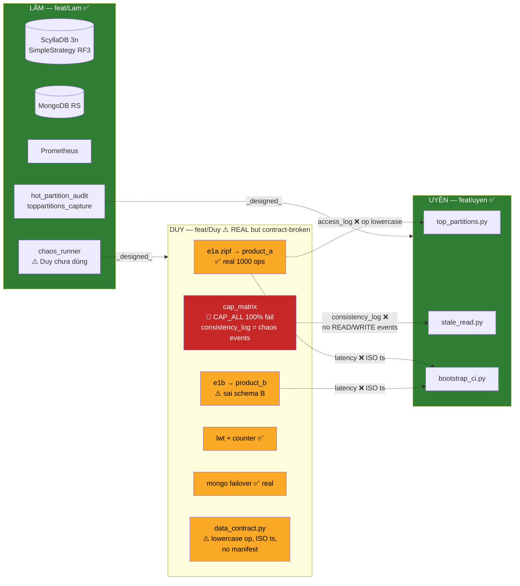

# TEAM PIPELINE COMPLETENESS AUDIT

> Audit read-only của `github.com/moon-1209/nosql-catalog-cap-lab`, thực hiện sau khi Duy hoàn thành remediation (PR #13, #14 — ngày 18/11).
> Ngày audit: sau commit `eaa3852` (feat/Duy), `8a87c69` (feat/Lam), `38801e3` (feat/uyen-analysis-pipeline).

---

## 1. Executive Summary

Duy đã viết lại **toàn bộ** experiment layer: bỏ mock/sleep, chuyển sang ScyllaDB thật (Cassandra driver) + MongoDB RS thật (`replSetStepDown`), áp dụng Data Contract v2 (đúng 9 cột `access_log` + 10 cột `consistency_log`, `run_id`, `success`/`error`), và commit **bằng chứng chạy thật** (`experiments/*/20261118*/access_log.csv`, hàng nghìn ops). Đây là bước tiến lớn: lần đầu tiên repo có dữ liệu quan sát từ cluster thật.

**Nhưng** output của Duy vẫn **chưa tiêu thụ được** bởi pipeline Uyên vì 4 lệch contract kỹ thuật + 1 lệch thiết kế schema + thiếu `manifest.json`. Ngoài ra phát hiện **1 defect xác nhận** (CL=ALL fail 100% kể cả khi cluster healthy) và **2 vấn đề vệ sinh repo** (`.env`, `.pyc`, data output commit vào git, `docker/` trùng `compose/` của Lâm).

| Câu hỏi | Trả lời |
|---|---|
| Uyên hoàn thành pipeline? | **CÓ** (phần phân tích/mô phỏng) — vẫn thiếu đầu vào dữ liệu thật tương thích |
| Duy hoàn thành pipeline? | **MỘT PHẦN** — code chạy thật, nhưng contract bị vi phạm, CAP_ALL bị lỗi, stale-read không đo được |
| Lâm hoàn thành pipeline? | **CÓ** (phần infra) — chaos runner/audit sẵn sàng, chưa được dùng trong run thật của Duy |
| 3 pipeline tương thích? | **CHƯA** — integration FAIL ở 4 điểm contract |
| Pipeline chạy end-to-end? | **CHƯA** — chưa có đường nào từ cluster thật → module phân tích của Uyên |
| Blocker lớn nhất | Lệch contract v2 giữa log của Duy và reader của Uyên; CAP_ALL không đo được availability đúng |

---

## 2. Repository & Branch Audit

| Branch | Tip | Ngày | Commits | Quan hệ với main | Trạng thái |
|---|---|---|---|---|---|
| `main` | `de1d1bd` | 30/10 | 1 | — | Chỉ README; **không chứa implementation** |
| `develop` | `a2f4428` | 16/11 | 18 | unmerged | Work CŨ của Duy (trước remediation) — **đã lỗi thời** |
| `feat/Duy` | `eaa3852` | 18/11 | ~24 | unmerged; **6 ahead / 1 behind develop** | Work MỚI của Duy — chưa merge vào develop |
| `feat/Lam` | `8a87c69` | 17/11 | 5 | unmerged | Infra + scaleout-chaos hoàn chỉnh |
| `feat/uyen-analysis-pipeline` | `38801e3` | 17/11 | 15 | unmerged | Analysis pipeline + contract v2 đóng băng |
| `feat/infra`, `feat/scaleout-chaos` | | | | đã merge vào feat/Lam | Superseded |
| `feat/e1b-*`, `feat/cap-matrix-*`, `feat/lwt-*`, `feat/mongodb-rollback-*`, `feat/readme-*` | | 16/11 | | đã merge vào develop | Superseded (work cũ) |

**Phát hiện quan trọng:**
- Work mới nhất của Duy nằm **chỉ trên `feat/Duy`**, chưa merge vào `develop` — `develop` giờ chứa bản cũ đã bị thay thế. Hai nhánh diverged (feat/Duy 6 ahead, develop 1 ahead — commit merge `a2f4428`).
- `feat/duy-remediation-v2` đã merge + xóa remote (PR #13, #14).
- `main` trống — mọi deliverable đều nằm trên feature branches.

### File mới/sửa của Duy (a2f4428 → eaa3852)

- `scripts/data_contract.py` (**mới**) — writer contract v2.
- `scripts/e1a_zipf_workload.py`, `e1b_bucketing_workload.py`, `cap_matrix_e2_e5.py`, `mongodb_rollback_e6.py` — viết lại, ScyllaDB/Mongo thật.
- `scripts/lwt_experiment.py`, `counter_experiment.py` (**mới**) — ScyllaDB LWT/Counter thật.
- `docker/{scylla,mongo,cadvisor}.yml` + `docker/.env` + `.env` (**mới**) — trùng lặp `compose/` của Lâm.
- `experiments/*/20261118*/` — **output run thật** (≈11 run dirs).
- `scripts/__pycache__/data_contract.cpython-311.pyc` — **file biên dịch commit nhầm**.
- README — cập nhật provenance, tuyên bố "mock đã loại bỏ hoàn toàn" (đã verify: không còn mock fallback trong các script mới).

---

## 3. Uyên Pipeline Audit — `feat/uyen-analysis-pipeline` @ `38801e3`

| Stage | Expected | Actual | Status |
|---|---|---|---|
| Input data | products/access/consistency CSV | `seeder.py` deterministic, manifest v2 | COMPLETE |
| Validation | integrity checks | `validate()` PK dup + bucket consistency; `contracts.py` normalize status | COMPLETE |
| Data modeling | Schema A/B | `schemas.py`: A `((category_id),added_at,product_id)`; B `((category_id,bucket),added_at,product_id)`, `bucket=crc32(pid)%16` | COMPLETE |
| NoSQL design | CQL + access patterns | `docs/access-patterns/` | COMPLETE |
| Insert/storage | vào ScyllaDB | N/A — pipeline là analysis-side | NOT APPLICABLE (bên Duy) |
| Retrieval | đọc log CSV | `top_partitions`, `stale_read`, `bootstrap_ci` | COMPLETE |
| Integrity/consistency | failed ops excluded | v2: `success`/`error`/`run_id`, legacy-safe | COMPLETE |
| Error handling | invalid status không thành success | `unknown_status` bucket | COMPLETE |
| Testing | unit + regression | **34/34 tests pass** | COMPLETE |
| Output/integration | spec cho experiment team | contract v2 + data dictionary | COMPLETE |

**Thiếu duy nhất:** input `origin="observed"` từ run thật — phụ thuộc Duy/Lâm, không phải lỗi của Uyên.

## 4. Duy Pipeline Audit — `feat/Duy` @ `eaa3852` (PRIORITY)

### Verify bằng chứng chạy thật

| Experiment | Script | Run evidence | Quan sát |
|---|---|---|---|
| E1a Zipf Schema A | `e1a_zipf_workload.py` | `experiments/E1a_ScyllaDB/20261118163502_71591fb6/` — 1000 ops | **REAL** — ops xen kẽ write/read, success ~100% |
| E1b Bucketing | `e1b_bucketing_workload.py` | `.../20261118163826_70a13d55/` — 1000 ops | **REAL** — CRC32 bucket đúng công thức |
| CAP ONE | `cap_matrix_e2_e5.py` | `.../20261118164217_51d70a18/` — 4008 ops, all `success=true` | REAL — partition thật (`docker network disconnect`) |
| CAP QUORUM | | `.../20261118164246_1e06bf4f/` — 3916 ops all true | REAL — QUORUM sống sót partition (đúng lý thuyết) |
| CAP ALL | | `.../20261118164314_7e93eceb/` — **4158 ops, 100% false** | **DEFECT** — xem dưới |
| LWT | `lwt_experiment.py` | `LWT/20261118164826_d623b720/` — 50 ops | REAL — LWT `IF owner='Nobody'` |
| Counter | `counter_experiment.py` | `Counter/...` — 100 ops | REAL |
| E6 Mongo failover | `mongodb_rollback_e6.py` | `E6_Mongo_Failover/...` — 229 ops | **REAL** — `replSetStepDown` thật; 2 run dir 1-line là run lỗi bị commit |

### Defect xác nhận: CAP_ALL fail vô điều kiện

`experiments/CAP_ALL/.../access_log.csv`: **4158/4158 success=false**, gồm 358 ops trong 3s healthy (trước `partition_start` lúc 16:43:17) và 860 ops sau heal — error `NoHostAvailable` ("Unable to complete the operation against any host..."). Trong khi CAP_ONE/QUORUM cùng script đều ~100% success.

→ CL=ALL **không bao giờ thành công ngay cả khi cluster healthy** — khả năng cao driver mất toàn bộ connection sau lần disconnect/restore ở run QUORUM trước đó (node3 không rejoin), hoặc cluster chưa bao giờ đủ 3 node. So sánh với sim của Uyên (ALL healthy 99.5% success), **đây là lỗi setup chứ không phải CAP evidence**. Cần rerun với verify `nodetool status` trước mỗi run.

### Vi phạm Data Contract v2 (đã kiểm chứng trên file thật)

| # | Contract yêu cầu | Duy thực tế | File:line | Hậu quả |
|---|---|---|---|---|
| C1 | `op ∈ {READ, WRITE}` (uppercase) | `"write"`, `"read"`, `"lwt_buy"`, `"increment"` lowercase | `e1a_zipf_workload.py`, `data_contract.py` pass-through | `top_partitions` group by `"READ"/"WRITE"` → **0 reads/0 writes, share NaN** — FAIL |
| C2 | `ts` = epoch ms (int64, sorted, merge_asof) | ISO8601 string | `data_contract.py: write_*` | `stale_read.merge_asof` TypeError trên object dtype — FAIL |
| C3 | `consistency_log`: event ∈ {WRITE,READ} + `version` monotonic | event = `"partition_start"/"partition_end"/"failover_start"`, `key="ALL"`, `version="1"` | `cap_matrix_e2_e5.py:64,84` | `stale_read` tìm 0 READ/WRITE → **không đo được stale rate** — FAIL |
| C4 | `manifest.json` per run (`origin`,`seed`,`git_sha`,`config`,`created_at`,`run_id`) | **Không file manifest nào** trong 11 run dirs | `data_contract.py` (không có hàm) | `run_info()` không verify được provenance; `origin` không phân biệt được observed/simulated — FAIL |
| C5 | `category_id` phải có nghĩa catalog | CAP/LWT/Counter để trống; E1a dùng `key % 10` (không lấy từ `products.csv`) | `e1a_zipf_workload.py:62` | Phân tích hot-partition theo category sai semantics — PARTIAL |

### Lệch thiết kế schema

| Schema | Spec (Uyên) | Duy implement | Đánh giá |
|---|---|---|---|
| A | `PRIMARY KEY ((category_id), added_at, product_id)` — category là partition | `PK (category_id, product_id)` — category_id VẪN là partition key nhưng thiếu `added_at`, dùng `int` thay uuid/text, `key%10` → chỉ 10 category | PARTIAL — gần đúng, không đọc `products.csv` |
| B | `PK ((category_id, bucket), added_at, product_id)`, `bucket=crc32(product_id)%16` | `PK (bucket_id, product_id)` — **bucket toàn cụm, mất category** | INCORRECT — đo không tương đương Schema B của spec; E1a vs E1b so sánh workload khác nhau (zipf vs sequential i=1..1000) |
| CAP table | — | `product_cap(id, val)` không version column → **không thể đo stale-read** vì không log version trả về | INCORRECT cho E2–E5 |
| Replication | docs yêu cầu `NetworkTopologyStrategy` RF=3 | `SimpleStrategy` RF=3 trong mọi script | PARTIAL — `apply_schema.sh` của Lâm đã cảnh báo đúng vấn đề này |

### Vệ sinh repo

- `.env` + `docker/.env` committed (chỉ lab config, không secret — nhưng đã có `.env.example` convention).
- `scripts/__pycache__/data_contract.cpython-311.pyc` committed.
- ~11 run dirs + CSV hàng nghìn dòng commit vào git — nên là artifact ngoài repo hoặc `experiments/` cần `.gitignore` + curated sample.
- 2 run dir lỗi (1-row logs: `E1a_..._c27b4a93`, `c940cf8a`, `E6_..._00f5fe93`, `6848c04d`) commit lẫn vào evidence.
- `docker/` trùng chức năng `compose/` của Lâm — hai bộ infra song song sẽ conflict khi merge.

## 5. Lâm Pipeline Audit — `feat/Lam` @ `8a87c69`

| Stage | Expected | Actual | Status |
|---|---|---|---|
| Cluster | ScyllaDB 3-node/3-rack + Mongo RS | `compose/` verified (audit trước) | COMPLETE |
| Monitoring | Prometheus+cAdvisor+Grafana | `monitoring/` | COMPLETE |
| Chaos | inject có kiểm soát | `chaos.sh` + `chaos_runner.py` (591 dòng, timeline, snapshot, `@mongo-primary` alias, phase marks) | COMPLETE (chưa verify runtime) |
| Schema apply | nạp CQL an toàn | `apply_schema.sh` + cảnh báo SimpleStrategy | COMPLETE |
| Experiment support | đo hot partition thật | `hot_partition_audit.py` (Prometheus, 6 views), `toppartitions_capture.py`, `run_e1.sh` (A-vs-B), `add_node4.sh` | COMPLETE |
| Integration Duy | `--harness-cmd` gọi workload | designed trong `chaos_runner` + `scenarios/e1_hot_partition.json` | **NOT VERIFIED** — Duy chưa chạy qua chaos_runner, tự `docker network disconnect` thay vì dùng tool chung |
| Integration Uyên | xuất CSV/JSON cho phân tích | `hot_partition_audit` docstring nói "cho Uyên vẽ biểu đồ" | **NOT VERIFIED** — schema output chưa khớp contract v2 |

## 6. Unified Team Pipeline Diagram

## 7. Requirement Completeness Matrix

| ID | Requirement | Owner | Expected | Actual | Status |
|---|---|---|---|---|---|
| R1 | Schema A per-category + CQL | Uyên(spec)/Duy(apply) | `((cat),added_at,pid)` | spec ✅; apply thiếu added_at, 10 cat giả | PARTIAL |
| R2 | Schema B bucketing | Uyên/Duy | `((cat,bucket),...)` | `bucket_id` toàn cụm, mất category | INCORRECT |
| R3 | E1a zipf workload real Scylla | Duy | Zipf + access_log v2 | ✅ real, ❌ op case | PARTIAL |
| R4 | E1b cùng workload để so sánh | Duy | cùng phân bố với E1a | sequential i=1..1000 ≠ zipf | INCORRECT |
| R5 | CAP E2–E5 CL ONE/QUORUM/ALL | Duy | partition thật + stale + availability | partition ✅; ALL defect; stale không đo | PARTIAL |
| R6 | LWT/Counter oversell | Duy | real CAS | ✅ LWT `IF`, Counter native | COMPLETE |
| R7 | E6 rollback/failover thật | Duy | RS failover | ✅ replSetStepDown real | COMPLETE |
| R8 | Contract v2 (9+10 cột, manifest, run_id) | Duy | đầy đủ | header ✅; op/ts/event/manifest ❌ | PARTIAL |
| R9 | Analysis consume real data | Uyên | modules đọc observed | modules sẵn; input chưa tương thích | BLOCKED |
| R10 | Chaos tooling | Lâm | chaos_runner | ✅ | COMPLETE |
| R11 | Monitoring + toppartitions | Lâm | Prom + nodetool capture | ✅ | COMPLETE |
| R12 | Harness qua chaos_runner | Duy+Lâm | `--harness-cmd` | Duy tự disconnect, không qua runner | MISSING |
| R13 | Provenance origin=observed | Duy | manifest per run | không manifest | MISSING |
| R14 | Merge về 1 branch chung | Team | develop/main | 3 nhánh riêng; develop lỗi thời | MISSING |

## 8. Integration Compatibility Matrix

| Integration Point | Producer | Consumer | Expected | Actual | Status |
|---|---|---|---|---|---|
| access_log → top_partitions | Duy | Uyên | op ∈ {READ,WRITE}, category_id, product_id | `"write"`/`"read"`/`"lwt_buy"` → 0 counted | **FAIL** |
| access_log → bootstrap_ci | Duy | Uyên | latency_ms + success | cột đúng, dùng được | PASS (sau khi chấp nhận ISO ts parse — latency module không cần ts) |
| consistency_log → stale_read | Duy | Uyên | event READ/WRITE + version + ts numeric | events = chaos markers, version="1", ts ISO | **FAIL** |
| manifest → run_info | Duy | Uyên | manifest.json v2 | không tồn tại | **FAIL** |
| products.csv → cluster seed | Uyên | Duy | load catalog vào product_a/b | Duy tự sinh `key%10`, không đọc CSV | **FAIL** |
| workload → chaos_runner | Duy | Lâm | `--harness-cmd` | không tích hợp | NOT IMPLEMENTED |
| chaos_runner → network_state label | Lâm | Duy/Uyên | gắn NORMAL/PARTITIONED vào log | Duy ghi vào consistency_log (sai chỗ) | PARTIAL |
| compose/ vs docker/ | Lâm | Duy | 1 bộ infra | 2 bộ song song, cùng net `lab-net` may conflict | **FAIL** |
| feat/Duy → develop | Duy | team | merge remediation | unmerged, diverged | MISSING |

## 9. Gap Analysis

**A. Missing Implementation**
- `manifest.json` writer trong `data_contract.py` (P0).
- Consistency event logger thật: WRITE/READ events với `version`, `node`, `network_state` (P0).
- Adapter/loader `products.csv` → cluster (P1).
- Integration test: run Duy output → Uyên modules (P0).

**B. Incomplete Implementation**
- CAP_ALL: rerun sau verify cluster health; thêm `nodetool status` check pre-run (P0).
- E1b: cùng Zipf workload với E1a, schema đúng `((cat,bucket))` (P1).
- Product catalog: dùng `products.csv` thay `key%10` (P1).
- `network_state` per-op trong access_log (hiện chỉ có chaos markers) (P1).
- `docker/` vs `compose/` — chọn 1 (P2).

**C. Integration Problems**
- op enum case (P0 — 1 dòng fix), ts format (P0), consistency_log semantics (P0), manifest (P0).
- Nhánh `develop` lỗi thời — cần merge feat/Duy hoặc làm develop mới (P1).

**D. Testing Problems**
- feat/Duy: **0 test file**. Không có test nào verify contract output.
- Không integration test cross-member.
- CAP_ALL defect chỉ lộ ra nhờ audit thủ công — cần assertion tự động.

**E. Documentation**
- README feat/Duy đã cập nhật tốt (provenance, run commands).
- Thiếu: hướng dẫn chạy end-to-end thống nhất; data dictionary của Duy vs Uyên chưa merge.

## 10. Technical Risk Assessment

| Priority | Issue | Impact | Evidence |
|---|---|---|---|
| Critical | op/ts/event contract mismatch → analysis chạy ra kết quả rỗng/NaN mà không báo | Toàn bộ pipeline "chạy được" nhưng số liệu sai/vắng | §8 FAIL rows |
| Critical | CAP_ALL defect → kết luận "ALL chết trong partition" không có bằng chứng healthy | CAP matrix sai | `CAP_ALL` csv: 358/358 fail pre-partition |
| High | consistency_log chứa chaos markers, không chứa consistency data → stale rate E2–E5 không đo được | Mất nửa CAP evidence | `cap_matrix_e2_e5.py:64` |
| High | E1a/E1b không comparable (zipf vs sequential; schema B sai) | E1 comparison vô nghĩa | §4 schema table |
| High | develop lỗi thời, feat/Duy diverged | team pull nhầm bản cũ | rev-list 6/1 |
| Medium | SimpleStrategy vs NTS trên 3-rack topology | replica placement sai với AZ model | mọi script `CREATE KEYSPACE` |
| Medium | `.pyc`, `.env`, 16k dòng CSV trong git | repo phình, data nhạy cảm config | diff stat |
| Medium | `LocalAddressTranslator`→127.0.0.1 mọi node | driver chỉ thực sự nói chuyện 1 contact point — có thể chính là nguyên nhân CAP_ALL | `e1a:13` |
| Low | error message cắt 50 chars | mất chẩn đoán | `cap_matrix: str(e)[:50]` |

## 11. Prioritized Team Action Plan

| Priority | Task | Owner | Depends | Acceptance |
|---|---|---|---|---|
| P0 | `data_contract`: uppercase ops, epoch-ms ts, viết `manifest.json` (origin=observed, git_sha, config, run_id) | Duy | — | Uyên `run_info()` = ok |
| P0 | `consistency_log` đúng semantics: log READ/WRITE events với `version` trả về; chaos events ghi sang file riêng `chaos_events.csv` | Duy | — | `stale_read.run()` tìm được reads |
| P0 | Fix CAP_ALL: `nodetool status` verify 3/3 UN trước run; giữ `network_state` per-op; rerun | Duy | Lâm cluster | ALL healthy ops >90% success; partition ops fail |
| P0 | Integration smoke test: `top_partitions.run()` + `stale_read.run()` trên 1 run dir của Duy | Duy+Uyên | 3 P0 trên | chạy không lỗi, số liệu nonzero |
| P1 | E1a/E1b đọc `products.csv`, cùng Zipf keys, schema B đúng `((cat,bucket))` | Duy | Uyên `data/full` | hot-partition A-vs-B so sánh được |
| P1 | Chạy workload qua `chaos_runner --harness-cmd` (thay tự disconnect) | Duy | Lâm | run có phase_marks chuẩn |
| P1 | Merge feat/Duy → develop (hoặc reset develop), resolve `docker/` vs `compose/` | Team | P0 | 1 infra duy nhất |
| P1 | NetworkTopologyStrategy + `apply_schema.sh` cho mọi keyspace | Duy | Lâm | `apply_schema` không còn warning |
| P2 | Thêm tests cho data_contract (contract v2 shape) | Duy | — | unittest pass |
| P2 | `.gitignore`: `__pycache__/`, `.env`, `experiments/*/run_*` lớn; giữ 1 sample run curated | Duy | — | repo sạch |
| P3 | Update docs: unified run guide, merge data dictionaries | Team | — | README end-to-end |

## 12. Final Conclusion

1. **Uyên: COMPLETE** cho phạm vi của mình — nhưng chưa thể chứng minh trên real data vì input chưa tương thích.
2. **Duy: PARTIAL** — bản chất đã từ "mock/MongoDB" thành "real ScyllaDB/MongoDB" (bước nhảy lớn, đáng ghi nhận), nhưng contract v2 chỉ đúng ở header, sai ở semantics; CAP_ALL là defect xác nhận; stale-read chưa đo được.
3. **Lâm: COMPLETE** — infra/chaos/audit sẵn sàng; còn thiếu việc được dùng.
4. **Tương thích: CHƯA** — 4 điểm FAIL contract, tất cả fix được trong ~1 ngày code.
5. **End-to-end: CHƯA** — chưa một module của Uyên đọc được real output của Duy.
6. **Để tuyên bố hoàn thành cần:** 4 P0 fixes + rerun 3 experiment + 1 integration smoke test + merge về develop. Các mảnh đã đủ — chỉ thiếu bước chuẩn hóa contract và một lần chạy thống nhất.
