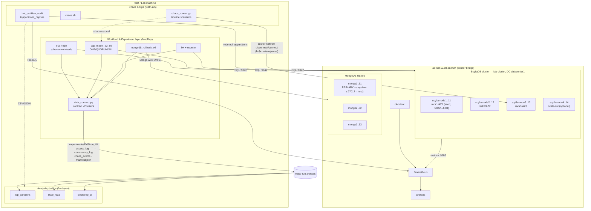

# PROJECT ARCHITECTURE

> Mô tả kiến trúc THỰC TẾ trong repo (feat/Duy + feat/Lam + feat/uyen-analysis-pipeline).
> Phạm vi: local Docker lab — KHÔNG phải public cloud deployment.

## Component overview

## Vai trò từng thành phần

| Component | Công nghệ | Lý do chọn | Trạng thái |
|---|---|---|---|
| Catalog DB | ScyllaDB 5.4 (Cassandra-compatible) | Mô hình partition/clustering chuẩn cho bài toán hot partition; tablets + nodetool cho phép đo phân phối tải thật | IMPLEMENTED |
| Failover DB | MongoDB 6.0 RS `rs0` | Đối chiếu mô hình replication khác (single-primary election) với quorum-read của Scylla | IMPLEMENTED |
| Workload | Python + scylla-driver/pymongo | Replay `access_log.csv` chung → A/B comparable | IMPLEMENTED |
| Chaos | Docker network disconnect + `chaos_runner` scenarios | Partition thật ở tầng mạng, có timeline + phase marks | IMPLEMENTED |
| Observability | Prometheus + cAdvisor + Grafana | Node/shard load, latency, recovery — tách biệt experiment metrics | IMPLEMENTED (feat/Lam) |
| Analysis | pandas/scipy (iid + moving-block bootstrap) | Stale-read qua `merge_asof` version, hot partition, CI | VERIFIED |

## Replication trong thí nghiệm

- Keyspace `catalog`: `NetworkTopologyStrategy`, `datacenter1: 3` → mỗi rack/AZ 1 replica (đã chuyển từ SimpleStrategy theo cảnh báo `apply_schema.sh`).
- `cap_kv(key PK, version int)`: version client-assigned monotonic → đo stale-read bằng so sánh version quan sát vs committed.
- MongoDB RS: `replSetStepDown 10` ép primary mongo1 từ chức → election mongo2/3.

## Simulated locally vs real

- **Thật**: containers, network partition, failover election, workload, monitoring scrape.
- **Simulated**: dataset gốc (`data/sample`, `origin=simulated` — 5k products từ seeder Uyên); stale probabilities trong file sim của Uyên. Run thật ghi `origin=observed`.

## Limitations của deployment model

- Single-host Docker: "AZ" là rack labels, không phải vùng khả dụng thật — partition bằng `network disconnect` mô phỏng link failure, không phải AZ outage thật.
- `--developer-mode`, `--overprovisioned`: Scylla chạy non-production config (SMP=1, memory giới hạn).
- Không TLS, không auth — chỉ phù hợp lab nội bộ (xem `docs/markdown/deployment/PROJECT_SECURITY_AUDIT.md`).
- Không phải public cloud: không có yêu cầu AWS/GCP nào được xác nhận trong repo (rubric không có sẵn → NOT_REQUIRED tạm thời, xác nhận lại với GVHD).
